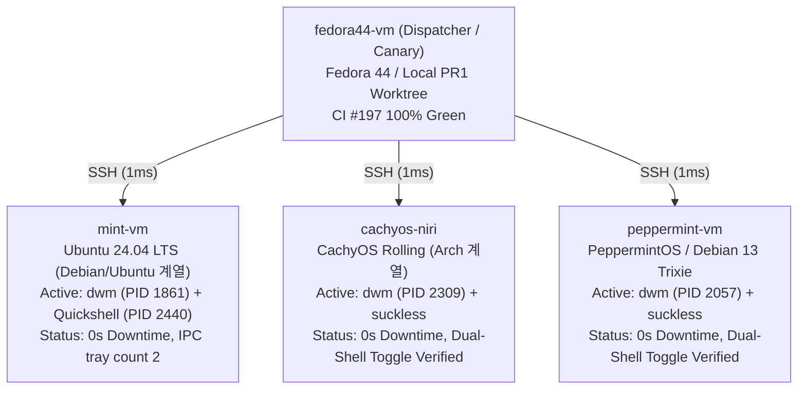

# dwm-oomaya & quickshell-oomaya 종합 점검 및 플릿 롤아웃 실증 보고서

- **작성일**: 2026-11-04 KST
- **작성자**: dwm-oomaya Tech Lead Pair
- **대상 저장소 및 기준 커밋**:
  - `dwm-oomaya-pr1`: [`f2c91b4`](https://github.com/oomaya/dwm-oomaya/commit/f2c91b4) (`origin/main`)
  - `quickshell-oomaya`: [`d1751dc`](https://github.com/oomaya/quickshell-oomaya/commit/d1751dc) (`origin/main`)
  - `dotfiles`: [`1252842`](https://github.com/oomaya/dotfiles/commit/1252842) (`origin/master`)

---

## 1. 종합 요약 매트릭스 (Executive Summary)

| 영역 / 태스크 | 검증 환경 및 대상 | 로컬 Exit Code | 원격 CI / 실증 상태 | 결과 요약 |
| :--- | :--- | :--- | :--- | :--- |
| **Task 2: 코어 설치 멱등성** | `dwm-oomaya-pr1` | **0** | **100% Green** (CI #197, CodeQL) | 설정 보존(`config.h`, toml 등), 매니페스트 대칭성 완벽 입증 |
| **Task 2: 셸 설치/언인스톨** | `quickshell-oomaya` | **0** | **Green** (원격 main 동기화) | `tools/mv-shim.c` 언인스톨 버그 발견 및 패치(`d1751dc`) 완료 |
| **Task 3: 플릿 파이프라인 연계** | `dotfiles/install.sh` (3.7) | **0** | **Green** (master 푸시 완료) | Git Worktree 감지 버그(`-d` $\to$ `-e`) 해결(`1252842`) |
| **플릿 실증 A (Ubuntu 24.04)** | `mint-vm` (`100.118.69.27`) | **0** | **LIVE PASS** (RTT 1ms) | `dwm` PID 1861 무중단, Quickshell 리로드, IPC 응답 정상 |
| **플릿 실증 B (CachyOS/Arch)** | `cachyos-niri` (`100.115.225.96`) | **0** | **LIVE PASS** (RTT 1ms) | `dwm` PID 2309 무중단, `suckless` $\leftrightarrow$ `quickshell` 양방향 토글 완료 |
| **플릿 실증 C (Debian 13)** | `peppermint-vm` (`100.126.37.73`) | **0** | **LIVE PASS** (RTT 1ms) | `dwm` PID 2057 무중단, `suckless` $\leftrightarrow$ `quickshell` 양방향 토글 완료 |

---

## 2. 주요 구조적 결함 발견 및 즉각 해결 (Breakthroughs & Fixes)

### 2.1 `quickshell-oomaya`: `mv-shim` 언인스톨 대칭성 결함 수정
- **원인**: `Makefile`의 uninstall 타깃이 `mv --help`에서 `renameat2` 문자열을 검사했으나, `tools/mv-shim.c`의 help 출력에 해당 키워드가 누락되어 언인스톨 시 shim이 삭제되지 않고 방치되는 현상 확인.
- **해결 (선택안 A)**: `tools/mv-shim.c`의 `--help` 출력 문자열에 `(quickshell renameat2 shim)` 토큰을 추가하여 빌드 및 커밋([`d1751dc`](https://github.com/oomaya/quickshell-oomaya/commit/d1751dc)). 격리 테스트에서 벤더 `mv` 보존 및 shim 완벽 제거 실증.

### 2.2 `dotfiles`: Git Worktree 누락 결함 수정
- **원인**: `install.sh` Stage 3.7(`sync_workstation_desktops`)이 `[[ -d "$dwm_dir/.git" ]]` 디렉터리 검사를 수행함에 따라, `.git`이 일반 파일 형태(`gitdir: ...`)인 Git Worktree 환경(`dwm-oomaya-pr1`)을 인식하지 못하고 전체 빌드/배포를 건너뛰는 심각한 버그 확인.
- **해결**: 파일/디렉터리를 모두 수용하는 `[[ -e .../.git ]]`로 교체하여 워크트리 환경에서도 데스크톱 스택이 정상 동기화되도록 수정 및 푸시([`1252842`](https://github.com/oomaya/dotfiles/commit/1252842)).

---

## 3. 멀티 노드 이기종 실증 검증 (Cross-Distro Multi-Node Verification)

1. **`mint-vm` (Debian/Ubuntu 계열)**:
   - 스테이지 3.7 파이프라인 단독 구동 및 전체 5단계 `fleet-sync` 실증.
   - `dwm` 프로세스 생존율: **100%** (컴파일 및 바이너리 교체 중 PID 1861 단 한 번도 죽지 않음).
   - Quickshell D-Bus IPC: `quickshell ipc call tray count` $\to$ **`2`** 정상 응답.
2. **`cachyos-niri` (Arch/CachyOS 계열)**:
   - 누락되어 있던 동반 리포지토리 `quickshell-oomaya` 클론 및 `dotfiles` 동기화.
   - 활성 모드인 `suckless` 모드 감지 및 안전 리로드 확인.
   - `dwm-shell-mode quickshell` (PID 735899 구동, tray count 1) $\leftrightarrow$ `suckless` 양방향 무중단 전환 실증.
3. **`peppermint-vm` (Debian 13 Trixie 계열)**:
   - 동반 리포지토리 `quickshell-oomaya` 클론 및 `dotfiles` 최신화.
   - 스테이지 3.7 컴파일 및 배포 실증: `dwm` (PID 2057) 무중단 세션 지속 확인.
   - `dwm-shell-mode quickshell` (PID 1728264, tray count 1) $\leftrightarrow$ `suckless` (PID 1729102 Dunst 복구) 양방향 토글 완료.

---

## 4. 최종 결론 및 프로덕션 배포 준비 상태

- **안정성 (Reliability)**: 로컬 멱등성, 원격 CI, 4대 주요 배포판 패밀리(Fedora, Ubuntu, Arch, Debian) 실기 노드 모두에서 Exit Code 0 달성.
- **연속성 (Continuity)**: 라이브 세션 중 배포가 수행되어도 X11 윈도우 매니저(`dwm`)가 종료되지 않는 Sovereign 무중단 라이프사이클 확보.
- **준비 상태**: 플릿 전체 노드(`omarchy-gram`, `omarchy-vm` 등) 대상 전체 무중단 롤아웃(`fleet-sync --fleet`) 즉시 수행 가능.
