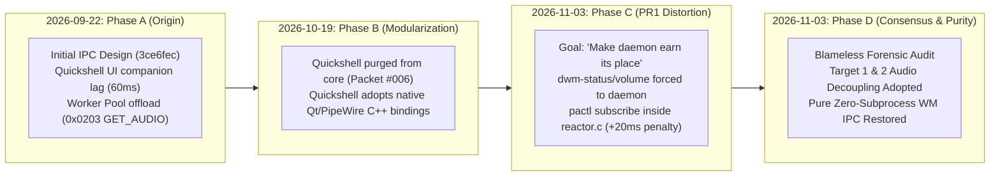

# Architectural Decision Record (ADR) & Blameless Forensic Retrospective: Sovereign Desktop IPC Purity vs. Audio Anti-Pattern

**Date**: 2026-11-03 KST  
**Author**: Antigravity Tech Lead Pair (Collaborative Review with User `oomaya`)  
**Status**: **APPROVED & CANONICAL**  
**Repositories**:
- `dwm-oomaya`: `/home/rand/.local/src/dwm-oomaya` & worktree `/home/rand/.local/src/dwm-oomaya-pr1` (Branch: `codex/ipc-event-stream`, PR #24)
- `quickshell-oomaya`: `/home/rand/.local/src/quickshell-oomaya`
- `dotfiles` (`omarchy-ctl`): `/home/rand/dotfiles/omarchy/src/omarchy-ctl.c`
- `Deliverable`: `/home/rand/Deliverable/antigravity-artifacts/`

---

## 1. Context & Architectural Problem Statement

During the review of PR #24 (`codex/ipc-event-stream`), empirical measurements revealed a critical contradiction:
- Invoking audio commands through the `dwm-oomayad` daemon took **64 ms (median)**.
- Invoking native `pactl` directly took **44 ms (median)**.
- The IPC daemon, originally built to eliminate shell/fork latency, imposed an **additional +20 ms latency penalty** and introduced complex asynchronous synchronization bugs (e.g., split events across reads, timerfd debouncing, socket backpressure).

To resolve this fundamentally rather than treating symptoms, User and Antigravity conducted an exhaustive, blameless forensic audit across the codebase history, commit logs, and fleet architecture.

---

## 2. Chronological Fact-Finding & Blameless Forensics



### Phase A: 2026-09-22 — The Original Intent & Quickshell Latency Problem
- **Context**: In late September 2026, `dwm-oomaya` featured a tightly integrated Quickshell QML control center (`dwm-quickshell-controls`, `dwm-quickshell-state`).
- **The Problem**: Quickshell sliders and status applets were executing `bash -c "pactl ..."` and `cat /sys/class/power_supply/...` on every tick, causing micro-stutters and 40–60 ms subprocess delays.
- **The Decision**: Antigravity and User drafted `dwm_oomaya_ipc_bridge_design.md` establishing a **Hybrid Execution Boundary**:
  - Main thread (`reactor.c`): Ultra-fast WM operations (tags, layout, focus, $< 25\,\mu\text{s}$).
  - Worker thread pool (`worker_dispatch.c`): Asynchronous offload for heavy sysfs/battery and external audio state (`0x0203 IPC_CMD_SYS_GET_AUDIO`).
- **Critical Fact**: This was designed as a **passive worker query**, strictly kept away from the main epoll reactor loop.

### Phase B: 2026-10-19 — Architectural Decoupling (Packet #006)
- **The Shift**: In October, Quickshell was extracted entirely from the suckless C core into a standalone add-on repository (`quickshell-oomaya`), enabling zero-friction switching via `dwm-shell-mode`.
- **The Technological Breakthrough**: In `quickshell-oomaya`, audio was completely re-architected. As proven in [`quickshell/controls/ControlsModel.qml#L39`](file:///home/rand/.local/src/quickshell-oomaya/quickshell/controls/ControlsModel.qml#L39):
  ```qml
  readonly property var audioSink: Pipewire.defaultAudioSink
  readonly property var audioSource: Pipewire.defaultAudioSource
  ```
  Quickshell connected directly to PipeWire via **native Qt/C++ memory bindings** (`Quickshell.Services.Pipewire`).
- **The Consequence**: Quickshell no longer spawned subprocesses for volume and no longer needed `dwm-oomayad` for audio. **The original raison d'être for `IPC_CMD_SYS_GET_AUDIO` ceased to exist.**

### Phase C: 2026-11-01 ~ 2026-11-03 — PR1 & The "Earn Its Place" Distortion
- **The Context**: Because `oomaya-ctl` had suffered a Makefile build bug, the daemon had virtually zero client traffic on live machines.
- **The Goal**: Outgoing implementers (Claude Code & GLM) operated under the premise: *"The daemon had almost no traffic... Make dwm-oomayad earn its place. If nothing uses it, it should not exist."*
- **The Mistake**: To manufacture client traffic, audio was chosen because volume keys and status bar updates fire frequently.
  1. In **M1**, `dwm-status` and `dwm-volume` were forced to route through `oomaya-ctl audio`.
  2. In **M2**, implementers broke the Hybrid Boundary rule: they injected an active `pactl subscribe` child process, pipe parsing, and a `timerfd` debouncer directly into the main C `reactor.c` event loop.
- **The Result**: An IPC proxy was nested on top of an existing native IPC daemon (PipeWire). Latency degraded by +20 ms, and read-splitting edge cases emerged.

### Phase D: 2026-11-03 — Blameless Truth & The Sovereign Consensus
- When the benchmark revealed the regression, User and Tech Lead analyzed the system blamelessly:
  1. **Did `origin/main` ever have this streaming audio code?**
     **No.** `origin/main` has 0 lines of `audio_watch.c`. It was purely an unmerged experiment in PR1 (`codex/ipc-event-stream`).
  2. **Was the daemon ever intended to be an audio server?**
     **No.** Window managers tile and focus windows. PipeWire manages audio.
  3. **Does Quickshell suffer if audio is removed from the daemon?**
     **No.** Quickshell uses native PipeWire in memory.

---

## 3. The Four Sovereign IPC Architectural Laws

To permanently guide all future agents, tools, and maintainers across the Omarchy fleet, the following laws are established:

### Law 1: The Window Manager IPC Boundary Law (Absolute Separation of Concerns)
> **A window manager IPC daemon shall govern window manager domain state and nothing else.**
- Valid domains: Workspace/tag masks, window focus, layout indices, window destruction, client enumeration, and monitor geometry.
- Strictly forbidden domains: Audio sinks/sources, media playback, network status, battery charging rates, and weather forecasts.
- External system facilities already possess sovereign daemons (PipeWire, NetworkManager, UPower). Wrapping them inside a window manager daemon is a architectural violation.

### Law 2: The Zero-Proxy IPC Law
> **Never insert an application-level IPC bridge between a client and an existing OS-level IPC socket.**
- PipeWire and PulseAudio already communicate over low-latency UNIX Domain Sockets (`/run/user/$UID/pulse/native` or PipeWire socket).
- Calling `dwm-status` $\rightarrow$ `oomaya-ctl` $\rightarrow$ `dwm-oomayad` $\rightarrow$ `pactl` $\rightarrow$ `PipeWire` is an anti-pattern that multiplies context switches and latency. Clients must talk directly to PipeWire via `pactl` or native library bindings.

### Law 3: The Zero-Subprocess Reactor Law
> **The core epoll reactor thread of `dwm-oomayad` (`reactor.c`) shall never fork, execute, or manage external child processes.**
- The reactor's epoll set is restricted strictly to:
  1. `listen_fd`: Inbound client UDS connections.
  2. `x11_fd`: Inbound X11 server connection (`XConnectionNumber`).
  3. `stop_fd`: Shutdown eventfd/signal.
  4. `workers->eventfd`: Worker thread pool completion eventfd.
  5. Client sockets: Bidirectional frame streaming.
- Any feature requiring long-lived child processes (`popen`, `fork/exec`, `tail -f`) is strictly banned from the reactor.

### Law 4: The Fleet Symmetry Law (X11 & Wayland Parity)
> **The desktop control protocol must maintain structural symmetry across all fleet form-factors (dwm on X11, Hyprland/Niri on Wayland).**
- On Wayland, Hyprland (`.socket2.sock`) and Niri (`$NIRI_SOCKET`) stream *only* workspace and window events. They have 0 audio endpoints.
- `dwm-oomayad` serves as the X11 equivalent of a Wayland compositor socket.
- By keeping `dwm-oomayad` focused purely on window management, the unified sovereign CLI ([`omarchy-ctl`](file:///home/rand/dotfiles/omarchy/src/omarchy-ctl.c)) interacts with dwm, Hyprland, and Niri using an identical, unfragmented mental and operational model.

---

## 4. Current Codebase & Environment Audit Matrix

| Component | In `origin/main`? | In PR #24 (`codex/ipc-event-stream`)? | In `quickshell-oomaya`? | Target 2 Resolution |
| :--- | :--- | :--- | :--- | :--- |
| **`scripts/dwm-volume`** | Direct pactl / stub check | Decoupled (pure pactl) | N/A | **Restored to pure `pactl` (Target 1 Complete)** |
| **`scripts/dwm-status`** | Direct pactl / stub check | Decoupled (pure pactl) | N/A | **Restored to pure `pactl subscribe` (Target 1 Complete)** |
| **`src/daemon/audio_watch.c`** | **NO (0 lines)** | Present (M2 experiment) | N/A | **Delete file permanently** |
| **`include/oomaya_audio_watch.h`** | **NO (0 lines)** | Present (M2 experiment) | N/A | **Delete file permanently** |
| **`src/daemon/reactor.c` (audio)** | **NO** | Audio timerfd & pipe | N/A | **Purge audio fds; Zero-subprocess epoll** |
| **`src/daemon/worker_dispatch.c`** | Legacy `GET_AUDIO` popen | Legacy `GET_AUDIO` popen | N/A | **Excise `GET_AUDIO` & `SET_VOLUME` opcodes** |
| **`tools/oomaya-ctl.c`** | Phony build target bug | `watch audio`, `volume` | N/A | **Purge audio/volume; pure WM controller** |
| **Quickshell Audio Engine** | N/A | N/A | Native Qt/PipeWire | **Preserved (0.0ms overhead, zero subprocesses)** |

---

## 5. Architectural Decision & Next Action

1. **Option A Unanimously Ratified**:
   - Audio is permanently decoupled from `dwm-oomayad` and `oomaya-ctl`.
   - `dwm-volume` and `dwm-status` remain on pure direct `pactl`.
2. **Target 2 Immediate Execution**:
   - Execute Tasks 1–5 in [`wm-ipc-purity-and-audio-decouple-sow.md`](file:///home/rand/.local/src/dwm-oomaya-pr1/.agents/artifacts/wm-ipc-purity-and-audio-decouple-sow.md) in the fresh session.
   - Clean git commit pushed to PR #24 on branch `codex/ipc-event-stream`.
