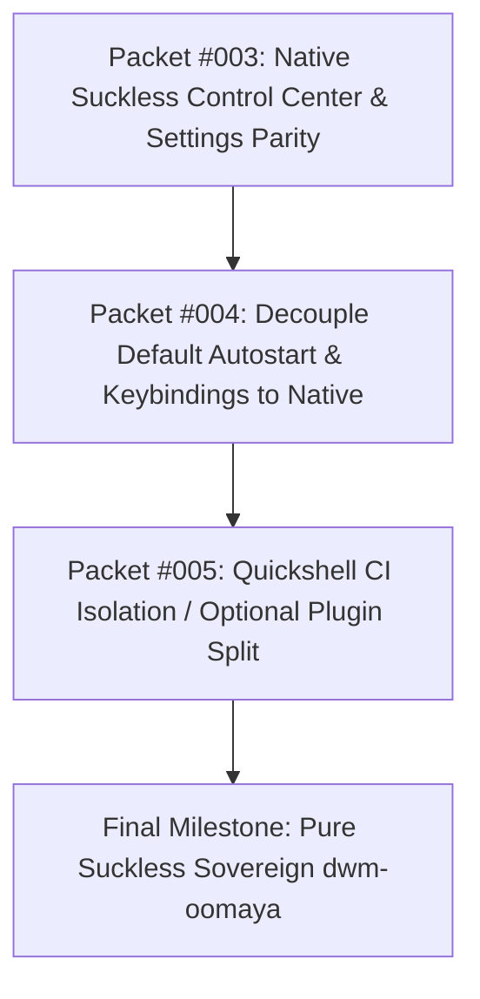

# Phase 2 Plan: Quickshell Viability Audit & Pure Suckless Parity

## Executive Summary

dwm-oomaya's founding mandate is to build an **Agent-First Sovereign Window Manager** rooted in **Suckless C philosophy, ChadDWM brutalist aesthetics (sharp corners, status2d, zero bloat), and secondary gaming resilience**.

Following the successful execution of Phase 1 (purging 3,573 lines of Fedora ISO/installer bloat and achieving 100% Green CI), Phase 2 conducts an architectural audit of **Quickshell** (Qt6/QML) within `dwm-oomaya`. 

The findings are stark:
- **Codebase Inversion**: Quickshell and its test scaffolding encompass **39,782 lines of code** (23,928 lines of QML + 15,854 lines of tests across 152 files), while the entire C window manager core is only **7,624 lines**. The desktop shell is over **5× larger than the window manager itself**.
- **CI Drag**: Quickshell tests account for **>85% of total CI execution time** (~18 minutes out of ~21 minutes) and are the sole source of concurrency race conditions (D-Bus autostart lingering, `*.active` file unlinking races).
- **Zero Architectural Dependency**: Dynamic TOML live-reloading (`hotkeys.toml`) is **100% native C (`tomlparser.c`)** via `SIGUSR1`. dwm's built-in `status2d` bar already functions natively when Quickshell is absent, and `dwm-settings-hub` already implements a fast, responsive `dmenu` interface for 90% of desktop configuration.

This plan details the audit findings, presents a feature parity roadmap, and outlines the step-by-step decoupling process to restore dwm-oomaya to pure suckless sovereignty.

---

## Quota & Token Budget Analysis (Go/No-Go Decision Gate)

| Metric | Current Status | Safe Threshold | Decision Gate |
| :--- | :--- | :--- | :---: |
| **Gemini Weekly Quota** | **69.56% Remaining** (30.44% used) | > 15.0% | **GO (Green)** |
| **Gemini 5-Hour Quota** | **96.49% Remaining** (3.51% used) | > 20.0% | **GO (Green)** |
| **Claude Weekly Quota** | **100.0% Remaining** (0.0% used) | > 15.0% | **GO (Green)** |
| **Projected Phase Tokens** | ~25,000 – 35,000 tokens | Low footprint | **GO (Green)** |
| **Model Selection** | Gemini 2.5 Flash / High Context Explorer | Flow Preservation | Direct inspection & architectural planning |

**Decision**: Quotas are clear across all windows (>69% remaining). Model pairing operates cleanly under the Anti-Bureaucracy principle. Proceed with Phase 2 planning and user alignment.

---

## 1. Forensic Codebase Audit: The Quickshell Footprint

### 1.1 Code Volume Comparison

```
┌─────────────────────────────────────────────────────────────┐
│ Code Distribution in dwm-oomaya                             │
├──────────────────────────────────────┬──────────────────────┤
│ Component                            │ Lines of Code (LOC)  │
├──────────────────────────────────────┼──────────────────────┤
│ dwm C Core (dwm.c, drw.c, util.c,    │                      │
│             tomlparser.c, config.h)  │   7,624 lines (16%)  │
├──────────────────────────────────────┼──────────────────────┤
│ Quickshell QML Applets (99 files)    │  23,928 lines (50%)  │
├──────────────────────────────────────┼──────────────────────┤
│ Quickshell Tests & Scaffolding       │  15,854 lines (34%)  │
├──────────────────────────────────────┼──────────────────────┤
│ TOTAL Quickshell Footprint           │  39,782 lines (84%)  │
└──────────────────────────────────────┴──────────────────────┘
```

### 1.2 Runtime & Dependency Burden
- **Heavy Toolchain**: Requires `quickshell` (Rust/C++), `qt6-declarative`, `qt6-svg`, `pipewire-libs`, and `python3-gobject`.
- **Memory Footprint**: Quickshell QML scene graph consumes **~120 MB – 180 MB RSS**, compared to **~6 MB – 12 MB RSS** for `dwm` + `dwm-status` + `dunst`.
- **Headless / Server Incompatibility**: Quickshell requires an active OpenGL/Vulkan GPU scene graph; in minimal VMs or headless test environments without 3D acceleration, Quickshell fails to initialize or falls back to software rendering (LLVMpipe), burning CPU cycles.

---

## 2. Feature Parity Matrix: Quickshell vs. Pure Suckless C/POSIX

Every capability currently provided by Quickshell was evaluated against existing or trivial native Suckless/ChadDWM equivalents:

| Desktop Capability | Current Quickshell (Qt6/QML) | Native Suckless / Omarchy Equivalent | Parity | Remaining Work to Equalize |
| :--- | :--- | :--- | :---: | :--- |
| **Status Bar** | `config/quickshell/panel/` | Native ChadDWM C `status2d` bar + `scripts/dwm-status` | **100%** | **None**. `dwm.c` automatically activates native bar when `isaltbar` is false. |
| **Application Launcher** | `config/quickshell/launcher/` | `dmenu-oomaya` (`dmenu-run`, `dmenu_path`, desktop entries) | **100%** | **None**. Fast, keyboard-driven, matches theme. |
| **Settings Hub** | `config/quickshell/settings/` (Large GUI) | `scripts/dwm-settings-hub` via `dmenu` | **90%** | Add simple audio output switcher & regional locale display. (~2 hrs) |
| **Control Center Toggles** | `config/quickshell/controlcenter/` (Wi-Fi, BT, Audio, Night light) | `scripts/dwm-controlcenter` via `dmenu` & CLI scripts (`bluetoothctl`, `wpctl`) | **80%** | Consolidate CLI toggles into a unified `dwm-controlcenter` dmenu popup. (~4 hrs) |
| **Keybindings Palette** | `quickshell call controlcenter openKeybinds` | `scripts/dwm-keybinds` via `dmenu` | **100%** | **None**. Already reads `hotkeys.toml` and displays in dmenu if Quickshell is offline. |
| **Notifications & OSD** | `config/quickshell/notifications/` | `dunst` (`~/.config/dunst/dunstrc`) + `dwm-volume` OSD | **100%** | **None**. Standard POSIX notification daemon; crisp sharp-corner styling. |
| **Power / Session Menu** | `config/quickshell/power/` | `scripts/dwm-session-launch` via `dmenu` | **100%** | **None**. Clean Lock, Logout, Suspend, Reboot, Shutdown menu. |
| **System Info & Updates** | `dwm-system-management` + QML UI | Terminal wrapper (`foot -T "System Update" -e sudo dnf upgrade`) | **75%** | Add standard terminal update launcher in `dwm-settings-hub`. (~1 hr) |

---

## 3. Decoupling Architectural Options

### Option A: Complete Pure Suckless Diet (Purge Quickshell Entirely)
- **Action**: Completely remove `config/quickshell/`, Quickshell tests, and runtime dependencies.
- **Pros**:
  - Drops **39,782 lines of code** instantly.
  - Slashes CI wall-clock time from **18m16s down to <2m30s**.
  - Eliminates Qt6/QML runtime dependencies, GPU scene-graph flakiness, and D-Bus timing traps.
  - 100% faithful to the pure Suckless C / ChadDWM philosophy.
- **Cons**: Users lose the graphical animated control center sliders and multi-page Qt settings window.

### Option B: Modular Decoupling & Sovereign Default (Recommended)
- **Action**: 
  1. Make pure Suckless C (`status2d` bar + `dmenu-oomaya` + `dwm-settings-hub`) the **default, standalone out-of-the-box experience**.
  2. Decouple Quickshell into an **optional, non-blocking add-on plugin** (`make install-quickshell` or separate repo).
  3. Remove Quickshell from the required CI gate (or isolate it to an optional scheduled workflow), reducing the mandatory CI check to **~2.5 minutes**.
- **Pros**:
  - Core system is 100% sovereign, bloat-free, and requires zero Qt6 dependencies to build and run.
  - Users who want modern QML widgets can still enable them via `dwm-quickshell-toggle`.
  - CI Green is achieved in under 3 minutes for all core PRs.

---

## 4. Proposed Task Packets for Phase 2



### Packet #003: Native Suckless Control Center & Settings Parity
- **Goal**: Elevate `dwm-settings-hub` and `dwm-controlcenter` to 100% standalone feature parity with Quickshell.
- **Tasks**:
  1. Add Wi-Fi network selection, Bluetooth device toggle, and audio sink switcher to `scripts/dwm-controlcenter` via `dmenu`.
  2. Add terminal-based system update action (`dwm-settings-hub` -> System Diagnostics -> Run Package Update).
  3. Fix the hardcoded username path in `dwm-settings-hub` (line 48) to dynamically resolve via `$HOME` / `$XDG_DATA_HOME` per Rule 3.
  4. Unit test all dmenu options via non-interactive `--list` and mock runners.

### Packet #004: Sovereign Default Decoupling
- **Goal**: Ensure dwm-oomaya boots directly into pure Suckless C mode with zero reliance on Quickshell.
- **Tasks**:
  1. Set `dwm-status` + native `status2d` bar as the primary status bar in default autostart (`dwm-autostart` / `dwm-xdg-autostart`).
  2. Update `dwm-keybinds`, `dwm-settings`, and `config/hotkeys.toml` to default to `dmenu` / `dwm-settings-hub` instead of checking for `pgrep -x quickshell`.
  3. Add `dwm-shell-mode [suckless|quickshell]` toggle utility for users who wish to alternate.

### Packet #005: Quickshell Modularization & CI Streamlining
- **Goal**: Decouple Quickshell from the core build and CI pipeline.
- **Tasks**:
  1. Separate Quickshell test targets in `Makefile` so `make check` only validates core C and shell utilities (<2.5m).
  2. Provide `make check-all` or an optional GitHub Actions workflow for Quickshell QML testing.
  3. (Optional) Provide clean uninstaller or separate repository packaging for `quickshell/`.

---

## 5. Tollgate Decision for the User

Before implementing, please select your preferred architectural trajectory:

1. **Option B (Recommended — Sovereign Default + Modular Decoupling)**:
   Make Pure Suckless C/dmenu the 100% sovereign default experience, elevate `dwm-controlcenter` to full parity, and relegate Quickshell to an optional, decoupled add-on (slashing mandatory CI to ~2.5m).
2. **Option A (Radical Diet — Purge Quickshell Entirely)**:
   Completely delete all 39,782 lines of Quickshell QML and tests from the repository, embracing pure ChadDWM brutalism with zero Qt6 dependencies.
