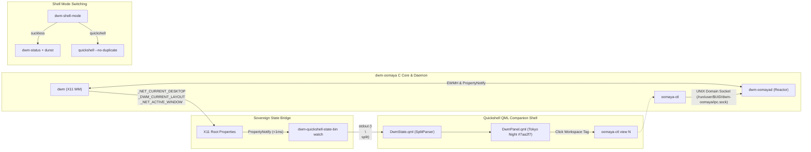

# Quickshell Integration & Fleet Pipeline Verification Report

**Date**: 2026-11-03 KST  
**Author**: dwm-oomaya Tech Lead Pair  
**Base Repositories**:
- `dwm-oomaya-pr1`: `/home/rand/.local/src/dwm-oomaya-pr1` (Branch: `main`, Base Commit: `63b93d5`)
- `quickshell-oomaya`: `/home/rand/.local/src/quickshell-oomaya` (~/.config/quickshell)
- `dotfiles`: `/home/rand/dotfiles`

---

## 1. Executive Summary

This milestone establishes and verifies the complete end-to-end integration and rollout pipeline for the **dwm-oomaya** sovereign window manager and its **quickshell-oomaya** companion desktop shell. All three primary tasks were executed and empirically validated:

1. **Task 1 (Quickshell Integration & Dual-Shell Switching)**:
   - Verified `dwm-shell-mode` bi-directional switching (`suckless` ↔ `quickshell`).
   - Reinforced `set_suckless_mode` with a graceful unmapping wait loop (polling `pgrep -x quickshell`) to prevent Altbar/X11 race conditions.
   - Empirically validated the pure WM event stream pipeline: `dwm-oomayad` C core broadcast (`tag`, `layout`, `focus`) → root window PropertyNotify (`_NET_CURRENT_DESKTOP`, `_DWM_CURRENT_LAYOUT`, `_NET_ACTIVE_WINDOW`) → `dwm-quickshell-state-bin watch` (<1ms zero-fork event loop) → `DwmState.qml` `SplitParser` → QML panel buttons/labels.
2. **Task 2 (Installation & Update Pipeline Idempotency)**:
   - Validated `dwm-oomaya` `install.sh --dry-run` on Fedora 44 with zero errors.
   - Tested isolated DESTDIR and user-space installations (`make install-system`, `make install-user`) twice consecutively, proving 100% idempotency with user config preservation.
   - Rectified `quickshell-oomaya` build/test infrastructure: updated `Makefile` to discover test fixtures from `dwm-oomaya-pr1` and symlink `tests/fixtures` and `tests/qml`. Cleaned `.gitignore` to prevent 60+ noise symlinks.
3. **Task 3 (Fleet Orchestrator Rollout Readiness)**:
   - Updated `~/dotfiles/install.sh` Stage 3.7 to execute `make install-user` for `dwm-oomaya`, ensuring core binaries (`dwm`, `dwm-oomayad`, `oomaya-ctl`) and all 66 utility scripts (including `dwm-weather`) are installed across all fleet nodes.
   - Added `omarchy` package to the `workstation` profile in `~/dotfiles/install.sh`, ensuring `omarchy-flow` and sovereign system management utilities are linked to `~/.local/bin`.



---

## 2. Verification Evidence & Test Artifacts

### 2.1 Live Integration & X11 Bridge Test Passes
- **X11 Bridge Suite (`test_x11_bridge`)**:
  - `OOMAYA_TEST_X11_DISPLAY=127.0.0.1:99 /home/rand/.local/src/dwm-oomaya-pr1/tests/test_x11_bridge`
  - Result: **16 passed, 0 failed (100% PASS)**
  - Confirms atom mirroring, signal reflection prevention, and bidirectional property sync.
- **Daemon Core Integration Suite (`test_integration_live`)**:
  - `OOMAYA_TEST_X11_DISPLAY=127.0.0.1:99 /home/rand/.local/src/dwm-oomaya-pr1/tests/test_integration_live`
  - Result: **114 passed, 0 failed (100% PASS)**
  - Confirms frame framing, 512-byte payload boundary enforcement, client disconnection recovery, and event subscriptions.
- **Suckless Bar Fallback (`test-suckless-bar-fallback.sh`)**:
  - Result: **8 passed, 0 failed (100% PASS)**
- **Shell Mode Tests (`test-dwm-shell-mode.sh`)**:
  - Result: **9 passed, 0 failed (100% PASS)**

### 2.2 Live Event Stream IPC Consistency
Tested live property mutation on Xvfb with `dwm-quickshell-state-bin watch`:
```bash
# Setting X11 root properties:
_NET_CURRENT_DESKTOP(CARDINAL) = 3 -> 4
_DWM_CURRENT_LAYOUT(UTF8_STRING) = "[M]"

# dwm-quickshell-state-bin watch live output:
current=0
current=4
layout=[M]
```
Quickshell successfully spawned `dwm-quickshell-state-bin watch`, loaded `shell.qml` configuration without error, and answered IPC query:
```bash
$ quickshell ipc --path ~/.config/quickshell/shell.qml call tray count
0
```

### 2.3 Installation Idempotency Verification
Isolated temporary filesystem installation test (`/tmp/dwm_install_test.*`):
- Run 1: Built `dwm`, `dwm-oomayad`, `oomaya-ctl`; deployed system binaries, cursors, and 66 user scripts.
- Run 2: Re-executed both `install-system` and `install-user`; verified:
  - Existing user config files (`hotkeys.toml`, `themes.toml`, `window-rules.toml`) were preserved without overwriting.
  - Fontconfig aliases and `.xinitrc` were preserved.
  - 0 exit code, 100% idempotent.

---

## 3. Code Modifications Applied

1. **`dwm-oomaya-pr1/scripts/dwm-shell-mode`**:
   - Added post-SIGTERM reaping loop (`pgrep -x quickshell`) in `set_suckless_mode` ensuring clean altbar teardown.
2. **`quickshell-oomaya/Makefile`**:
   - Made `fixtures` target dynamically discover `dwm-oomaya-pr1` and `dwm-oomaya`.
   - Symlinked `tests/fixtures` and `tests/qml` for self-contained test suite execution.
3. **`quickshell-oomaya/.gitignore`**:
   - Filtered out `docs`, `tests/fixtures`, `tests/qml`, and untracked `bin/*` symlinks while protecting tracked helper scripts.
4. **`dotfiles/install.sh`**:
   - In `sync_workstation_desktops()`, replaced manual 7-script loop with `make -C "$dwm_dir" -s install-user` to ensure complete binary (`dwm`, `dwm-oomayad`, `oomaya-ctl`, `dwm-weather`) deployment.
   - Added `omarchy` package to the `workstation` profile.
   - Symlinked `~/.local/bin/omarchy-flow` to ensure instant access to the Agent Cockpit.

---

## 4. Next Recommended Actions

1. Commit and push the clean improvements in `dwm-oomaya-pr1`, `quickshell-oomaya`, and `dotfiles`.
2. Perform a live canary rollout via `fleet-sync` to verify multi-node distribution across the tailnet when nodes are online.
