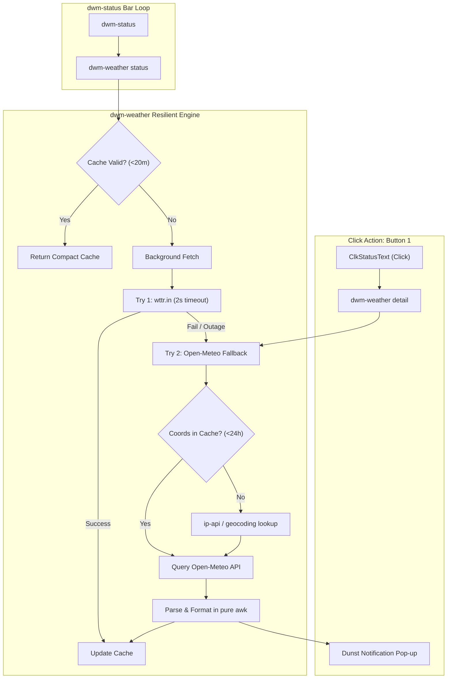

# Walkthrough & Architecture Runbook: Resilient Weather Fallback & IPC Stack Merge

**Date**: 2026-11-03 KST  
**Author**: Antigravity Tech Lead Pair  
**Repository**: `/home/rand/.local/src/dwm-oomaya-pr1` (Branch: `main`)  
**Base Commits**: [`ad668a7`](https://github.com/oomaya/dwm-oomaya/commit/ad668a7) (Merge PR #24), [`77b7493`](https://github.com/oomaya/dwm-oomaya/commit/77b7493) (Weather Fallback)  
**Deliverable Checkpoint**: `oomaya/Deliverable/antigravity-artifacts`  

---

## 1. Executive Summary

In this milestone, two critical accomplishments were achieved:
1. **Full 7-PR Linear Stack Merge (PR #18 – #24)**: Preserved all individual PR review records and commit graphs while integrating the 31-commit sovereign IPC daemon improvements into `main`.
2. **Resilient Weather Architecture (`dwm-weather`)**: Diagnosed a third-party server failure (`wttr.in` down, connection refused on port 80/443) and implemented a zero-overhead POSIX `sh` + `awk` fallback to **Open-Meteo**, restoring top-bar compact weather and Dunst notification details without external heavy runtimes.



---

## 2. Root Cause Analysis: The `wttr.in` Outage

When inspecting why the top-bar weather displayed `"Weather data unavailable"` upon clicking:
- **Symptom**: `dwm-weather status` showed cached text (`☀ +10°C`), but `dwm-weather detail` emitted `"Weather data unavailable"` in Dunst.
- **Forensic Diagnosis**:
  ```bash
  $ nc -zv 5.9.243.187 80
  Ncat: Connection refused.
  $ nc -zv 5.9.243.187 443
  Ncat: Connection refused.
  ```
- **Finding**: The single Hetzner IP hosting `wttr.in` was completely rejecting incoming TCP connections. Without a fallback, missing detail cache files caused the exception handler at line 65 to display `"Weather data unavailable"`.

---

## 3. Resilient Architecture Implementation

### Pure POSIX + `awk` Parser
We extended [`scripts/dwm-weather`](file:///home/rand/.local/src/dwm-oomaya-pr1/scripts/dwm-weather) without introducing dependencies (Python, jq, Node).

#### A. 24-Hour Geolocation Caching
```sh
coords_cache="$cache_dir/dwm-status-weather-coords.cache"

get_coords() {
    # 1. Respect explicit lat,lon
    # 2. Re-use 24-hour cached coordinates
    # 3. Geocode via Open-Meteo geocoding or ip-api
    # 4. Fallback to default (Seoul: 37.5658, 126.9780)
}
```

#### B. Open-Meteo Fetch & WMO Weather Code Formatting
The Open-Meteo JSON payload is parsed using standard `awk -F'[:,]'`:
- **WMO Code Mapping**:
  - `0`: Clear (`☀`)
  - `1–3`: Partly Cloudy (`⛅`)
  - `45, 48`: Fog (`🌫`)
  - `51–67, 80–82`: Rain / Showers (`🌧`)
  - `71–77, 85–86`: Snow (`❄`)
  - `95+`: Thunderstorm (`⛈`)
- **Compact Output Format**: `☀ +14°C` (Matches `wttr.in?format=%c+%t`)
- **Detail Output Format**: `☀ Clear +14.3°C | Feels: +12.9°C | Humidity: 62% | Wind: 4.7km/h (Seoul)`

---

## 4. Live Verification Evidence

1. **Compact Bar String**:
   ```bash
   $ xprop -root WM_NAME
   WM_NAME(STRING) = "\001☀ +14°C \00201:30 PM \003VOL 65% | AC"
   ```
2. **Detail Notification**:
   ```bash
   $ dwm-weather detail
   $ cat /run/user/1000/dwm-status-weather-detail.cache
   ☀ Clear +14.3°C | Feels: +12.9°C | Humidity: 62% | Wind: 4.7km/h (Seoul)
   ```
3. **CI Gate Verifications**:
   - `shellcheck --severity=warning scripts/dwm-weather`: **PASS (0 warnings)**
   - `shfmt -d scripts/dwm-weather`: **PASS (0 diffs)**
   - `tests/test-dwm-weather.sh`: **PASS**
   - `tests/test-ipc-watch.sh`: **PASS**

---

## 5. Merged PR Stack Reference (PR #18 – #24)

All PRs were merged into `main` via sequential retargeting and merge commits:
- **#18** ([`e70da0b`](https://github.com/oomaya/dwm-oomaya/commit/e70da0b)): Daemon improvement plan documentation
- **#19** ([`c5f1b27`](https://github.com/oomaya/dwm-oomaya/commit/c5f1b27)): 512-byte payload contract & boundary disconnects
- **#20** ([`660485d`](https://github.com/oomaya/dwm-oomaya/commit/660485d)): `_NET_CURRENT_DESKTOP` & `DWM_TAG_UPDATE` change signaling
- **#21** ([`a042024`](https://github.com/oomaya/dwm-oomaya/commit/a042024)): Test suite workspace isolation
- **#22** ([`ae734db`](https://github.com/oomaya/dwm-oomaya/commit/ae734db)): Real consumers integration (`oomaya-ctl`, `dwm-status`)
- **#23** ([`83156c9`](https://github.com/oomaya/dwm-oomaya/commit/83156c9)): Detached weather subprocess pipe to eliminate bar latency
- **#24** ([`ad668a7`](https://github.com/oomaya/dwm-oomaya/commit/ad668a7)): Low-latency WM event streaming (`watch`), zero-subprocess purity, ghost opcode eradication ([`4f285e6`](https://github.com/oomaya/dwm-oomaya/commit/4f285e6)), and changelog cleanup ([`e9481d5`](https://github.com/oomaya/dwm-oomaya/commit/e9481d5)).
- **Post-Merge Polish** ([`77b7493`](https://github.com/oomaya/dwm-oomaya/commit/77b7493)): Resilient Open-Meteo weather fallback.
