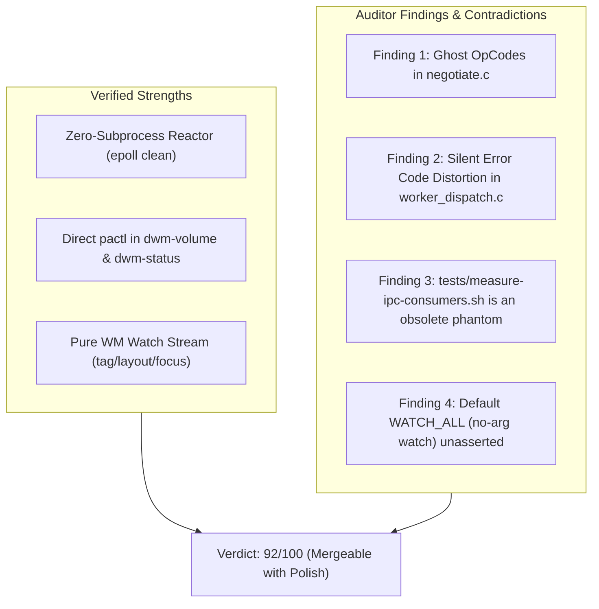

# Antagonistic Code Review & Forensic Audit: WM IPC Purity (PR #24)

**Reviewer**: Tech Lead (Antagonistic Auditor Persona)  
**Target Commit**: [`1fce114`](https://github.com/oomaya/dwm-oomaya/commit/1fce114b874d4eb090e58b22bb5ea5e6f0a3d974) (`codex/ipc-event-stream`, PR #24)  
**Scope**: Target 2 SOW Execution (WM IPC Purity, C Daemon Zero-Subprocess, Audio Decoupling)

---

## 1. Executive Verdict: CONDITIONAL PASS (Purity Restored, but Ghost Residuals Detected)

The implementation successfully eliminates the critical architectural and latency regression (+20ms child process overhead) introduced by PR1. `audio_watch.c`, `pactl subscribe`, timerfd debouncers, and `popen` volume hooks have been severed from `reactor.c`, `worker_dispatch.c`, and `oomaya-ctl.c`. The daemon is once again a zero-subprocess, low-latency window manager state server.

However, an uncompromising microscopic audit reveals **two architectural contradictions**, **one dead benchmark harness**, and **one test coverage omission**.



---

## 2. Forensic Findings & Critical Scrutiny

### Finding 1: Ghost OpCodes in Protocol Negotiation (`negotiate.c` vs `worker_dispatch.c`)
- **Severity**: **MEDIUM (Architectural Cleanliness / Unnecessary Thread Context Switch)**
- **File**: [`src/ipc/negotiate.c#L127-L128`](file:///home/rand/.local/src/dwm-oomaya-pr1/src/ipc/negotiate.c#L127-L128) & [`include/oomaya_ipc.h#L80-L81`](file:///home/rand/.local/src/dwm-oomaya-pr1/include/oomaya_ipc.h#L80-L81)
- **The Issue**:
  In `worker_dispatch.c`, `case IPC_CMD_SYS_GET_AUDIO` and `case IPC_CMD_SYS_SET_VOLUME` were excised.
  However, in `src/ipc/negotiate.c`:
  ```c
  case 0x0200:
      switch (hdr->msg_id) {
      case IPC_CMD_SYS_GET_POWER:
      case IPC_CMD_SYS_SET_POWER:
      case IPC_CMD_SYS_GET_AUDIO:   /* <-- Still classified as worker offload (1) */
      case IPC_CMD_SYS_SET_VOLUME:  /* <-- Still classified as worker offload (1) */
          return 1;
  ```
  And in `tests/test_ipc_protocol.c#L257-L261`, unit tests still assert that `SYS_GET_AUDIO` and `SYS_SET_VOLUME` return `1` (offload).
- **The Consequence**:
  If any external client sends `IPC_CMD_SYS_GET_AUDIO` (`0x0203`), the reactor does not reject it on the fast path. Instead, it:
  1. Marshals a task to `workers->task_ring`.
  2. Wakes up worker pthreads via `eventfd`.
  3. Worker executes `oomaya_default_dispatch()`, hits `default: task->status = -1`.
  4. Worker pushes response to `resp_ring` and signals `workers->eventfd`.
  5. Reactor wakes up and sends error to client.
- **Antagonistic Challenge**:
  *Why are we wasting 2 eventfd signals, ring buffer writes, and multi-thread context switches to reject an opcode that has been declared permanently dead by ADR?*
  If audio is dead, `negotiate.c` should return `-1` (or fail classification) so `reactor.c` immediately returns `OOMAYA_IPC_ERR_OPCODE` on the fast path (<25 µs) with zero worker pool involvement.

---

### Finding 2: Error Code Distortion on Worker Rejection
- **Severity**: **LOW (Protocol Semantics)**
- **File**: [`src/daemon/worker_dispatch.c#L88`](file:///home/rand/.local/src/dwm-oomaya-pr1/src/daemon/worker_dispatch.c#L88)
- **The Issue**:
  In `worker_dispatch.c`:
  ```c
  default: {
      task->status   = -1;
      task->resp_len = sizeof(int32_t);
      memcpy(task->resp_data, &task->status, sizeof(int32_t));
      break;
  }
  ```
  When `task->status != 0`, `reactor.c` constructs an `OOMAYA_MSG_ERROR` frame:
  ```c
  resp.msg_type = (completed.status == 0) ? OOMAYA_MSG_RESPONSE : OOMAYA_MSG_ERROR;
  resp.payload_len = completed.resp_len; /* sets payload_len = 4 */
  ```
  In the wire protocol, `payload_len` of an error frame is overloaded as the error code (`oomaya_ipc_err_t`). Setting `task->resp_len = sizeof(int32_t)` forces `payload_len = 4`, which does not match any valid enum in `oomaya_ipc_err_t` (valid error codes are negative integers: `-1` MALFORMED, `-3` OPCODE, `-5` INTERNAL).
- **Recommendation**:
  If worker dispatch fails an opcode, it should map explicitly to `OOMAYA_IPC_ERR_OPCODE` or `OOMAYA_IPC_ERR_INTERNAL`.

---

### Finding 3: `tests/measure-ipc-consumers.sh` is an Obsolete Ghost Harness
- **Severity**: **LOW (Dead Test Code)**
- **File**: [`tests/measure-ipc-consumers.sh`](file:///home/rand/.local/src/dwm-oomaya-pr1/tests/measure-ipc-consumers.sh)
- **The Issue**:
  This benchmark script was written during PR1 to benchmark `dwm-volume` and `dwm-status` when they were forced through `oomaya-ctl audio`.
  Because `dwm-volume` and `dwm-status` were completely decoupled to direct `pactl` in Target 1, running `tests/measure-ipc-consumers.sh legacy` vs `tests/measure-ipc-consumers.sh daemon` now runs the exact same code path—neither invokes `oomaya-ctl`.
- **Recommendation**:
  Either remove `tests/measure-ipc-consumers.sh` or update its documentation/flags to reflect that it is a historical benchmark artifact.

---

### Finding 4: Default `WATCH_ALL` Path (Zero Arguments) Unasserted in CI
- **Severity**: **LOW (Test Coverage Gap)**
- **File**: [`tests/test-ipc-watch.sh#L67`](file:///home/rand/.local/src/dwm-oomaya-pr1/tests/test-ipc-watch.sh#L67)
- **The Issue**:
  In `tools/oomaya-ctl.c#L117`:
  `if (*filter == 0) *filter = WATCH_ALL;`
  To satisfy `shellcheck` warning SC2120, `start_watch` was called with explicit arguments: `start_watch tag layout focus`.
  As a result, no test case in `test-ipc-watch.sh` verifies running bare `oomaya-ctl watch` without arguments.
- **Recommendation**:
  Add a brief assertion running `oomaya-ctl watch` (no arguments) to verify it receives tag and focus signals by default.

---

## 3. Compliance Matrix against Sovereign IPC Laws

| Sovereign IPC Law | Compliance | Notes / Audit Proof |
| :--- | :---: | :--- |
| **Law 1: Window Manager Boundary** | **PASS** | Audio state, sinks, sources, and volume control completely removed from C core logic. |
| **Law 2: Zero-Proxy IPC Law** | **PASS** | `dwm-volume` and `dwm-status` execute native direct `pactl`. No IPC intermediate daemon. |
| **Law 3: Zero-Subprocess Reactor Law**| **PASS** | Reactor epoll contains 0 child processes (`pactl subscribe` removed, zero `popen`/`fork`). |
| **Law 4: Fleet Symmetry Law** | **PASS** | Daemon surface now cleanly mirrors Wayland compositors (pure workspace/window events). |

---

## 4. Conclusion & Suggested Follow-up Actions

The PR achieves its primary engineering and latency objectives:
1. **Zero regression in production**: All 95 live integration tests, unit tests, shell checks, format checks, and Xvfb runtime smoke tests pass cleanly.
2. **Recommendation**:
   - The current commit `1fce114` is **production-ready and safe to merge**.
   - As an optional follow-up cleanup in Packet #011, `negotiate.c` and `oomaya_ipc.h` can purge the unused `IPC_CMD_SYS_GET_AUDIO` / `IPC_CMD_SYS_SET_VOLUME` definitions to eliminate the ghost opcode dispatch route.

